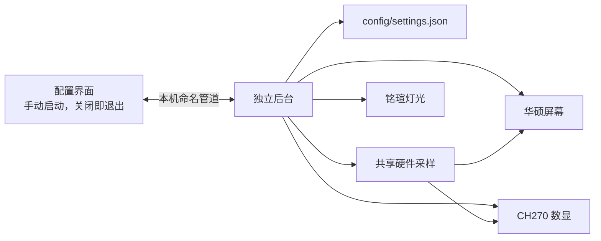
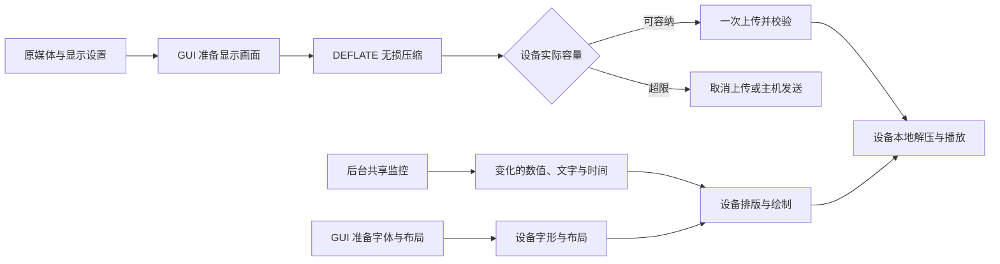

# 聚合argb驱动

Windows x64 原生设备控制程序，集中配置以下三种设备：

- 铭瑄 MS-Terminator B850M PRO：常亮、关闭、呼吸、彩虹、循环、星空、彗星、波浪、智能监控、音乐与键鼠联动；分组、亮度、颜色和各模式参数。
- 华硕 PRIME SLC II 360 ARGB LCD：硬件监控、图片/GIF/MP4/AVI、监控叠加、实时预览、自定义布局、裁剪与动画片段、媒体库、顺序/随机轮播、亮度、旋转及固件维护。
- DeepCool CH270：固定 CPU 频率页、固定 CPU 风扇页、GPU 页、轮播顺序和各页停留时间、独立风扇来源、温度单位及数据缺失策略。

`HardwareLite.exe` 是手动打开的配置界面；`HardwareLite.Service.exe` 是后台控制程序。关闭设置窗口会退出界面进程，后台继续工作。后台没有托盘和设置窗口，不引用 AntdUI；硬件采样只运行一份，两个屏幕共享快照。



通过 Windows WinUSB/HID 直接通信，监控使用 LibreHardwareMonitor 0.9.6。界面使用 [AntdUI 2.4.12](https://github.com/AntdUI/AntdUI) 原生 WinForms 组件。两程序使用 .NET 8 Windows Desktop 运行时，硬件监控需要管理员权限以及 PawnIO 2.2。配置和已导入的字体、媒体保留在程序旁的 `config` 目录；原厂控制程序运行时会暂停对应设备接管，避免并行写入。

默认每秒采样，水冷输出保持 720×720；发送帧率上限可在界面中设置为 1–60 FPS，新配置默认 60 FPS，已有配置保留保存值。后台将绘制、编码和传输耗时计入帧间隔，不以整数除法缩短发送周期。帧率上限不改变媒体原有播放速度；实际新画面数量取决于源帧率、解码、编码和 USB 传输耗时。静态灯光仅在设置变化时写入；静态画面仅在内容或设置变化时重新编码。屏幕画布、JPEG 编码缓冲及 USB 发送缓冲复用；GIF 绘制源使用原生克隆，释放只用于重新保存动画的整文件字节缓存。共享采样只保留实时快照，不累计没有界面消费者的传感器历史。停用屏幕会释放画布与媒体解码器。没有设备或界面需要监控数据时关闭采样器，再次需要时重新连接。

后台视频输出按实际解码帧序号去重：源帧和监控文字均未变化时，保留已有画面，不重复合成、JPEG 编码和发送；静态保活继续生效。硬件视频复用一张只读暂存纹理，将实际输出帧读回后立即归还解码样本，位图直接引用暂存纹理的映射内存；切换帧或释放设备时，先释放位图，再解除映射。CPU 视频缓冲使用只读锁持有当前样本，省去额外源位图和整帧复制。两种路径保留源尺寸与原有裁剪、缩放。GUI 的默认画布继续使用原有复制路径，两种实例不共享帧状态。

共享监控页面可选择独立显卡、CPU 风扇、AIO 泵、系统风扇和主板温度通道。通用传感器名称不能确定主板上的测温位置，需要选择实际通道；读不到的值显示 `--`。

布局编辑器支持拖动、右下角缩放、方向键微调、项目增删和顺序调整，以及字体、颜色、标题、说明、对齐和背景裁剪。可显示指定传感器、文字、日期、数字或指针时钟。编辑器保存后仍需在主窗口点击“保存并应用”；取消编辑保留原配置。裁剪预览可放大到 800%，滚轮围绕光标缩放，右键拖动平移，“适应窗口”恢复原比例；预览缩放和平移不会改变已保存的选区。拖动选区、右下角调整大小、Shift 重新选区及动画起止片段保留。媒体库移除项目不会删除原文件。视频使用 Windows Media Foundation，实际格式与编码支持取决于本机解码器。

水冷页的“画质与播放”提供 JPEG 质量、独立预览帧率、GIF 延时、播放倍率、缩放算法、媒体库容量、静态保活及随机去重。视频可选择软件、硬件或自动处理，并指定实际显示适配器。使用 CPU 核显时选择“启用硬件加速”和核显名称，例如 AMD Radeon(TM) Graphics，再保存并应用。适配器选择与共享监控中的 GPU 数据来源独立；视频处理使用核显，监控仍可显示独显数据。0×0 处理尺寸保留源尺寸，实体输出继续为 720×720。硬件处理可能改变颜色转换、插值或取帧时点；创建 D3D 设备不等于证明所有解码步骤都由 GPU 完成。

灯光页提供独立分组配置、更新间隔、输出设备／麦克风／应用音频来源、FFT 和响应参数、自定义渐变及输入触发类型。应用音频采集需要支持进程回环的 Windows 版本。共享监控页提供硬件类别、各指标来源、CPU 频率统计方式、过期时间及后台重连策略。高级表单先保存草稿，主窗口“保存并应用”后才提交后台。

“开机自启”使用当前用户的 Windows 计划任务 `HardwareLite`，以管理员权限直接启动后台程序。旧版指向同目录 `HardwareLite.exe --tray` 的任务会迁移到后台；属于其他程序的同名任务不会修改。重复打开界面会激活已有设置窗口。“停止后台并退出”释放设备并结束两程序；关闭窗口仅退出界面。

构建需要 .NET 10 SDK（解决方案和固件打包工具使用其格式），运行桌面程序需要 .NET 8 Windows Desktop x64 运行时；硬件监控还需要已安装的 PawnIO 2.2。克隆仓库后，在项目目录构建两个发行程序到同一目录：

```powershell
dotnet publish .\src\HardwareLite.Service\HardwareLite.Service.csproj -c Release -o .\dist\HardwareLite
dotnet publish .\src\HardwareLite\HardwareLite.csproj -c Release -o .\dist\HardwareLite
```

更新文件前应正常退出正在使用该目录的旧程序。运行 `HardwareLite.Service.exe` 只启动后台；运行 `HardwareLite.exe` 打开设置并连接后台，后台未启动时会启动它。`HardwareLite.exe --exit` 请求正常停止已有程序；`--tray` 为旧启动任务的迁移入口，只启动后台后退出。

固件维护接受 PRIME SLC II LCD 封装升级包，校验机型、平台、长度、CRC 与确认后的文件 SHA-256。只有选择文件并确认后才开始写入；更新期间后台拒绝暂停、退出和改变设备配置。分块确认在设备写入和同步闪存后返回；最终要求重新连接并取得匹配的正常设备信息。

设备内播放使用扩展固件的媒体接口。GUI 先应用已有裁剪、布局、旋转、播放片段和倍率，只把最终 720×720 显示内容编码为设备视频。源帧率低于上限时保持源帧率，超过上限时降到用户选择的 1–60 FPS；重复画面延长显示时间，不生成额外补帧。处理后的视频再使用 64 KiB 分块 DEFLATE 压缩，设备向原生播放器提供解压后的随机读文件，不需要主机逐帧发送动画。

GUI 的“设备媒体编码”提供 H.264 裁剪视频和无损画面两种选择，视频码率可以手动设置为 128–20000 kbps，默认 2000 kbps。H.264 重新编码会改变像素；后续 DEFLATE 对处理后视频字节的压缩可逆。无损画面使用 DEFLATE 关键帧与帧间差分，保留准备后的像素，但可能需要更多存储空间。单项动画可准备为设备视频，媒体列表使用无损画面轨道。关闭 GUI 后，已上传的动画由设备播放器继续播放。

接口版本 6 的扩展固件支持设备端监控绘制。GUI 保存时按实际字体准备字形、标题、说明和布局，字形包保存在本机 `config/device-ui`；连接时上传到设备内存，不占用动画文件的闪存位置。字形包分别保存普通文字框与紧排数字的字符度量，固件接受已有版本 1 和新版本 2；连续空行、空文字和空布局保留原显示规则。后台只发送变化的数值、短文字和时间，设备执行排版、裁剪、旋转、合成与指针绘制。抗锯齿边缘可能与 GDI+ 整段文字绘制略有差异。亮度等设置变化时保留已缓存的有效监控读数。设备内播放期间后台释放主机画布和 JPEG 资源。旧接口继续使用像素叠加；主机发送模式保留原有媒体处理路径。过大的字形包会阻止保存并提示调整字体或改用主机发送模式。

硬件拓扑、传感器目录和选择结果在设备或配置变化时重建；采样保留完整实时数据。三设备共享一次进程冲突扫描，按已设置的检查间隔更新。常亮或关闭灯效在设置未变化时跳过构帧；智能、音乐和输入联动仍按各自数据更新。HID 报告、灯效颜色及 USB 回应缓冲由对应设备实例复用。

设备端监控文字的通信缓冲从 256 字节起按需增长，最大仍为 200 KiB；一般布局不再常驻分配完整上限。数值格式、字符编码和设备协议保持一致。

保存前使用设备返回的实际可用容量。媒体包超过上限时停止准备，并提供“取消上传”和“使用主机发送”；取消保留当前显示，主机发送保留原媒体及全部显示设置。压缩比例取决于画面内容，不能保证大文件会缩小到设备容量以内。MP4 和 GIF 本身已经使用压缩编码，准备后的显示媒体也可能比原文件大。容量判断使用实际待上传的媒体包，不能根据原文件大小预先认定可容纳。



“已发送画面”表示图像完整写入设备，并在收到有效信息时显示固件版本；它不能证明实体面板已经显示。原厂三套内置 MP4 背景在本机安装目录存在时导入本地配置，这些私有素材和字体不作为公共发行资源分发。启动、监控和通信异常分别写入程序旁的 `logs` 目录。

CH270 协议及前后端职责划分参考 [DeepCool-CH270-Lite](https://github.com/DiaMeoww/DeepCool-CH270-Lite)，MIT 声明见 `docs/licenses`。LibreHardwareMonitor 使用 MPL-2.0；未修改库源码，源码与许可证见 [上游项目](https://github.com/LibreHardwareMonitor/LibreHardwareMonitor/tree/v0.9.6)。音乐采集和媒体接口使用 NAudio 2.2.1（MIT）；AntdUI 使用 Apache-2.0。固件的 DEFLATE 解压使用 miniz 3.0.2（MIT），来源与许可证保存在 `firmware/prime_slc/third_party/miniz`。未包含原厂私有 DLL。

仓库由 [kltyton](https://github.com/kltyton) 维护。原厂名称用于说明适配机型，本项目与这些厂商无隶属关系。公开源码不包含个人配置、媒体、字体、原厂升级包或已合成的升级包。第三方代码按随附许可证使用；项目自有代码尚未指定开源许可证。

固件扩展源码与打包工具见 [固件构建说明](firmware/prime_slc/README.md)。扩展目前只匹配白色 PRIME SLC II LCD 的 D21x 1.0.4 镜像，不能直接用于其他颜色、机型或平台。未经扩展的原厂固件仍可使用主机发送模式。
